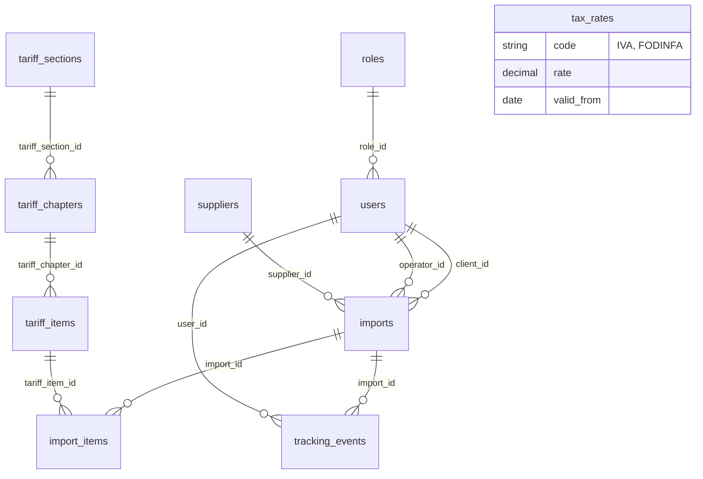

# ImportaTrack EC


[](https://importatrack-ec.onrender.com)

Sistema web para que una agencia de carga gestione las importaciones de sus clientes hacia Ecuador. Calcula la **liquidación de importación** (CIF, Ad Valorem, FODINFA, IVA y costo unitario puesto en bodega) y el **indicador de cumplimiento** de tiempos con semáforo.

> Ingeniería Web (ISWZ3101) · Universidad de las Américas (UDLA) · Autor: Sebastián Almachi

**Aplicación en línea:** <https://importatrack-ec.onrender.com> (usuario `admin@importatrack.ec`, contraseña `ImportaTrack2026`)

## Tabla de contenidos

1. [Funcionalidades](#funcionalidades)
2. [Tecnologías](#tecnologías)
3. [Arquitectura MVC](#arquitectura-mvc)
4. [Requisitos del profesor y dónde están en el código](#requisitos-del-profesor-y-dónde-están-en-el-código)
5. [Rutas](#rutas)
6. [Requisitos previos](#requisitos-previos)
7. [Instalación y ejecución](#instalación-y-ejecución)
8. [Cómo usar la aplicación](#cómo-usar-la-aplicación)
9. [Base de datos](#base-de-datos)
10. [Pruebas](#pruebas)
11. [Despliegue en Render](#despliegue-en-render)
12. [Estructura del proyecto](#estructura-del-proyecto)
13. [Autor](#autor)

## Funcionalidades

Módulo de **Administración** (entregado):

| Módulo | Qué hace el Administrador |
|---|---|
| **Usuarios** | CRUD de administradores, operadores y clientes (importadores), con rol, empresa y RUC/cédula validado en el servidor |
| **Proveedores del exterior** | CRUD con país de origen (dropdown) |
| **Partidas arancelarias** | CRUD del arancel con su % Ad Valorem, con dropdown en cascada Sección → Capítulo |
| **Tasas de tributos** | Configura el IVA (15%) y el FODINFA (0,5%) que usa la liquidación |
| **Importaciones** | Consulta todas las importaciones con su liquidación, su semáforo de cumplimiento y su historial de eventos |

El **Core** vive en los modelos y ya se puede ver en las importaciones de demostración:

| Cálculo | Fórmula |
|---|---|
| CIF | FOB + flete + seguro |
| Ad Valorem | % de la partida arancelaria × CIF |
| FODINFA | 0,5% × CIF |
| IVA | 15% × (CIF + Ad Valorem + FODINFA) |
| Costo unitario puesto en bodega | (CIF + tributos + gastos locales) ÷ cantidad |
| Desviación de tiempos | (días reales − días estimados) ÷ días estimados |

El semáforo marca **A tiempo** si la desviación es 0 o menor, **Retraso leve** hasta 20% y **Retraso crítico** por encima de 20%.

Pendiente para el Progreso 2: panel del Operador (registro de importaciones y eventos), panel del Cliente (sus importaciones y el simulador) y rastreo público por código.

## Tecnologías

| Capa | Tecnología | Para qué se usa |
|---|---|---|
| Lenguaje | PHP 8.3 | Lógica del servidor |
| Framework | Laravel 12 | Patrón MVC, rutas, validación y autenticación |
| ORM | Eloquent | Modelos, relaciones, migraciones y seeders |
| Base de datos | PostgreSQL (producción) y SQLite (local y pruebas) | Persistencia; se cambia solo con `DB_CONNECTION` |
| Vistas | Blade | Plantillas HTML semánticas con layouts y componentes |
| Estilos | Tailwind CSS 4 | Diseño Mobile First (360 px primero, luego `md:`) con tokens de diseño en `@theme` |
| Tipografía | IBM Plex Sans e IBM Plex Mono | Interfaz legible y cifras con `tabular-nums`, alineadas por columna |
| Empaquetado | Vite 7 | Compila y minifica el CSS y el JS |
| JavaScript | Vanilla ES6 (`fetch`) | Dropdown en cascada; sin frameworks |
| Pruebas | PHPUnit 11 | 45 pruebas unitarias y funcionales |
| Despliegue | Docker (PHP 8.3 + Apache) en Render | Producción |

## Arquitectura MVC

El flujo siempre es el estándar de Laravel: **ruta → controlador → FormRequest → modelo Eloquent → vista Blade**.

| Capa | Responsabilidad | Archivos |
|---|---|---|
| **Modelo** | Estructura, relaciones y cálculos del Core | `app/Models/`: `Role`, `User`, `Supplier`, `TaxRate`, `TariffSection`, `TariffChapter`, `TariffItem`, `Import`, `ImportItem`, `TrackingEvent` · `app/Enums/`: `ImportStatus`, `CustomsChannel`, `TransportMode`, `Compliance` · `app/Support/Money.php` |
| **Vista** | Solo presentación | `resources/views/layouts/` (`app`, `guest`) · `resources/views/components/` (`button`, `input`, `field`, `form-actions`, `table`, `panel`, `badge`, `status-badge`, `compliance-badge`, `cifra`, `page-header`, `nav-link`, `delete-button`, `empty`) · `resources/views/partials/` (`head`, `flash`) · `resources/views/admin/` (una carpeta por módulo) · `resources/views/auth/login.blade.php` |
| **Controlador** | Flujo de cada petición | `app/Http/Controllers/Admin/`: `DashboardController`, `UserController`, `SupplierController`, `TariffItemController`, `TariffChapterController`, `TaxRateController`, `ImportController` · `app/Http/Controllers/Auth/LoginController.php` · `app/Http/Controllers/HomeController.php` |
| Validación | Reglas del servidor | `app/Http/Requests/Admin/`: `UserRequest`, `SupplierRequest`, `TariffItemRequest`, `TaxRateRequest`, `ImportFilterRequest` · `app/Http/Requests/Auth/LoginRequest.php` · `app/Rules/EcuadorianId.php` |
| Rutas | Definen las URL | `routes/web.php` |
| Seguridad | Acceso por rol | `app/Http/Middleware/EnsureRole.php` (`role:ADMIN`) |

Los cálculos están en los modelos, como en el diagrama de clases:

- `Import`: `totalFob()`, `calculateCif()`, `calculateTaxes()`, `calculateLandedCost()`, `calculateDeviation()`, `getCompliance()`, `liquidation()`
- `ImportItem`: `fobTotal()`, `calculateCif()`, `calculateAdValorem()`, `calculateFodinfa()`, `calculateIva()`, `liquidate()`
- `App\Support\Money`: trabaja en centavos enteros para no perder precisión (15% de 2.408,90 da 361,34 y no 361,33) y reparte el flete entre los productos sin perder centavos.

## Requisitos del profesor y dónde están en el código

### 1. Dato sensible validado en el back-end: RUC / cédula

El RUC del importador se valida **en el servidor** antes de guardarse. El formulario usa `novalidate` y no hay validación de RUC en JavaScript: aunque se desactive el JS o se envíe la petición con Postman, un RUC inválido no llega a la base de datos.

- `app/Rules/EcuadorianId.php`: regla propia con el algoritmo ecuatoriano:
  - **Cédula y RUC de persona natural** (tercer dígito 0-5): módulo 10, coeficientes 2,1,2,1…
  - **RUC de sociedad privada** (tercer dígito 9): módulo 11, coeficientes 4,3,2,7,6,5,4,3,2
  - **RUC del sector público** (tercer dígito 6): módulo 11, coeficientes 3,2,7,6,5,4,3,2
  - Revisa también el código de provincia (01-24 o 30) y el establecimiento (001…).
- `app/Http/Requests/Admin/UserRequest.php`: aplica la regla. Si el rol es **Cliente**, exige RUC de 13 dígitos y empresa, y controla que el RUC no se repita.
- `tests/Unit/EcuadorianIdTest.php` y `tests/Feature/UserValidationTest.php`: pruebas con identificaciones válidas, alteradas y enviadas de forma manipulada.

### 2. Claves foráneas con dropdowns en cascada

Ninguna clave foránea se escribe a mano: el rol del usuario y los filtros por cliente, proveedor o sección son dropdowns. La cascada sigue la estructura del **Arancel del Ecuador**:

```
Sección (I … XXI)  →  Capítulo (01 … 97)  →  Partida (10 dígitos)
```

Al crear una partida se elige la **sección** y el dropdown de **capítulos** se llena solo con los de esa sección.

- `routes/web.php`: ruta `GET /admin/tariff-sections/{section}/chapters`
- `app/Http/Controllers/Admin/TariffChapterController.php`: devuelve los capítulos en JSON
- `resources/js/app.js`: `initCascades()` hace el `fetch` y llena el `<select>` hijo
- `app/Http/Requests/Admin/TariffItemRequest.php`: el servidor **vuelve a validar** que el capítulo pertenezca a la sección y que el código empiece con los 2 dígitos del capítulo
- Si el servidor rechaza el formulario, el controlador devuelve los capítulos ya cargados, así que el dropdown funciona aunque el JS no cargue

El dropdown de **Partida** (tercer nivel) se usará en el formulario de productos de una importación, que es parte del Progreso 2.

## Rutas

Todas están en `routes/web.php`. Las de `/admin` exigen sesión iniciada y rol Administrador.

| Método | URL | Controlador | Qué hace |
|---|---|---|---|
| GET | `/login` | `LoginController@create` | Formulario de inicio de sesión |
| POST | `/login` | `LoginController@store` | Inicia sesión (máximo 10 intentos por minuto) |
| POST | `/logout` | `LoginController@destroy` | Cierra la sesión |
| GET | `/` | `HomeController` | Envía a cada usuario al área de su rol |
| GET | `/admin` | `DashboardController` | Panel de administración |
| GET, POST | `/admin/users` | `UserController@index`, `@store` | Lista y crea usuarios |
| GET | `/admin/users/create` · `/admin/users/{user}/edit` | `UserController@create`, `@edit` | Formularios |
| PUT, DELETE | `/admin/users/{user}` | `UserController@update`, `@destroy` | Actualiza y elimina |
| … | `/admin/suppliers` | `SupplierController` | CRUD de proveedores (mismas 6 rutas) |
| … | `/admin/tariff-items` | `TariffItemController` | CRUD de partidas (mismas 6 rutas) |
| GET | `/admin/tariff-sections/{section}/chapters` | `TariffChapterController@bySection` | Capítulos de una sección en JSON (cascada) |
| GET | `/admin/tax-rates` | `TaxRateController@index` | Tasas vigentes |
| GET | `/admin/tax-rates/{taxRate}/edit` | `TaxRateController@edit` | Formulario de una tasa |
| PUT | `/admin/tax-rates/{taxRate}` | `TaxRateController@update` | Guarda la tasa |
| GET | `/admin/imports` | `ImportController@index` | Lista de importaciones con filtros |
| GET | `/admin/imports/{import}` | `ImportController@show` | Liquidación, semáforo e historial |

Para verlas todas: `php artisan route:list`.

## Requisitos previos

- Windows 10 u 11
- [Laravel Herd](https://herd.laravel.com), que instala PHP 8.3 o superior, Composer y Node.js
- Git

No hace falta instalar un servidor de base de datos: en local se usa SQLite, que es un archivo.

## Instalación y ejecución

En PowerShell:

1. Clona el repositorio y entra a la carpeta:
   ```powershell
   git clone https://github.com/S3B4XX/ImportaTrack-EC.git
   cd ImportaTrack-EC
   ```
2. Instala las dependencias de PHP:
   ```powershell
   composer install
   ```
3. Instala las dependencias de JavaScript y compila los estilos:
   ```powershell
   npm install
   npm run build
   ```
4. Crea tu archivo de configuración y la clave de la aplicación:
   ```powershell
   copy .env.example .env
   php artisan key:generate
   ```
5. Crea el archivo de la base de datos SQLite:
   ```powershell
   New-Item database\database.sqlite -ItemType File
   ```
6. Crea las tablas y carga los datos de demostración:
   ```powershell
   php artisan migrate --seed
   ```
7. Levanta la aplicación:
   ```powershell
   php -S 127.0.0.1:8000 -t public
   ```
8. Abre <http://127.0.0.1:8000> en el navegador.

> Se usa `php -S` y no `php artisan serve` porque en Windows este último puede fallar con el error "Unable to start curl module".

Para volver a dejar la base como al inicio: `php artisan migrate:fresh --seed`.

## Cómo usar la aplicación

Ábrela en línea en <https://importatrack-ec.onrender.com> o en local en <http://127.0.0.1:8000> (ver [Instalación y ejecución](#instalación-y-ejecución)).

Usuarios de demostración (todos con la contraseña `ImportaTrack2026`):

| Rol | Correo | Qué puede ver |
|---|---|---|
| Administrador | `admin@importatrack.ec` | Todo el panel de administración |
| Operador | `operador@importatrack.ec` | Pantalla de bienvenida (su panel es del Progreso 2) |
| Cliente | `compras@importadoraandina.ec` | Pantalla de bienvenida (su panel es del Progreso 2) |
| Cliente | `logistica@tecnoparts.ec` | Pantalla de bienvenida |
| Cliente | `jorge.salazar@gmail.com` | Pantalla de bienvenida |

Recorrido sugerido con el Administrador:

1. **Usuarios → Nuevo usuario**: elige el rol Cliente y escribe un RUC con el dígito verificador incorrecto (por ejemplo `1798765431001`). El servidor lo rechaza y muestra el error junto al campo.
2. **Partidas → Nueva partida**: elige una sección y observa cómo se cargan solo sus capítulos (dropdown en cascada).
3. **Importaciones → IMP-2026-0001**: es el ejemplo de la especificación. Su costo puesto en bodega es **$13.649,78** (36,5% sobre el FOB) y su desviación es de 13,3%, que corresponde a **Retraso leve**.
4. **Tasas**: cambia el IVA y vuelve a la importación; la liquidación usa el nuevo valor.

## Base de datos

| Entorno | Motor | Dónde está | Configuración |
|---|---|---|---|
| Local (Windows) | SQLite | Archivo `database/database.sqlite` | `DB_CONNECTION=sqlite` en `.env` |
| Pruebas | SQLite en memoria | No guarda nada en disco | `phpunit.xml` |
| Producción (Render) | PostgreSQL | Base gratuita de Render (`importatrack-db`) | `DB_CONNECTION=pgsql` y `DB_URL` |

El código es el mismo en los dos motores: solo cambia `DB_CONNECTION`. Las migraciones usan únicamente el constructor de esquemas de Laravel, sin SQL propio de ningún motor.

Tablas del proyecto: `roles`, `users`, `suppliers`, `tax_rates`, `tariff_sections`, `tariff_chapters`, `tariff_items`, `imports`, `import_items` y `tracking_events`. Laravel agrega `sessions`, `cache` y `jobs`.



Los montos son `decimal(12,2)` y las tasas `decimal(5,2)`. El estado, el canal de aforo y el modo de transporte son columnas `enum`: Laravel las crea como texto con una restricción que solo acepta los valores de la lista.

El seeder carga 3 roles, 5 usuarios, 4 proveedores, las 21 secciones y 96 capítulos del arancel, 36 partidas y 3 importaciones de ejemplo.

## Pruebas

```powershell
php artisan test
```

Son 45 pruebas: validación de RUC/cédula, dropdown en cascada, permisos por rol, tasas y la liquidación del ejemplo de la especificación. Corren en SQLite en memoria, así que no tocan tu base local.

## Despliegue en Render

La aplicación está publicada en **<https://importatrack-ec.onrender.com>**. Cada `git push` a la rama `main` vuelve a desplegarla automáticamente.

El repositorio trae `Dockerfile` (PHP 8.3 + Apache) y `render.yaml`. Para desplegarla desde cero:

1. Genera una clave con `php artisan key:generate --show` y cópiala.
2. En [Render](https://render.com) elige **New → Blueprint** y conecta este repositorio.
3. Cuando lo pida, pega la clave en `APP_KEY` y crea el Blueprint. Render crea la base PostgreSQL y el servicio web.
4. En cada arranque el contenedor ejecuta las migraciones y carga los datos iniciales **solo si la base está vacía** (`php artisan app:bootstrap`).

> Límites del plan gratuito de Render: el servicio se duerme tras unos minutos sin uso, así que la primera visita puede tardar cerca de un minuto; y la base PostgreSQL gratuita expira 30 días después de creada.

## Estructura del proyecto

```
ImportaTrack-EC/
├── app/
│   ├── Enums/                  # Estados, canal de aforo, transporte y semáforo de cumplimiento
│   ├── Http/
│   │   ├── Controllers/        # Controladores: Admin/, Auth/ y HomeController
│   │   ├── Middleware/         # EnsureRole: permite el acceso según el rol
│   │   └── Requests/           # FormRequests: toda la validación del servidor
│   ├── Models/                 # Modelos Eloquent con relaciones y cálculos del Core
│   ├── Rules/                  # EcuadorianId: validación de RUC y cédula
│   └── Support/                # Money: operaciones con dinero en centavos
├── config/
│   └── catalogs.php            # Listas fijas para dropdowns (países, incoterms)
├── database/
│   ├── migrations/             # Definición de las tablas
│   ├── seeders/                # Datos iniciales y arancel
│   └── database.sqlite         # Base local (no se sube al repositorio)
├── docker/
│   └── entrypoint.sh           # Arranque del contenedor en Render
├── lang/es/                    # Mensajes de validación y errores en español
├── public/                     # Punto de entrada (index.php) y assets compilados
├── resources/
│   ├── css/app.css             # Tailwind: tokens de diseño (@theme) y tipografía
│   ├── js/app.js               # JavaScript vanilla: dropdown en cascada
│   └── views/
│       ├── layouts/            # app (con sesión) y guest (login)
│       ├── components/         # x-button, x-input, x-field, x-table, x-badge, x-cifra… (estilo centralizado)
│       ├── partials/           # head y mensajes flash
│       ├── auth/               # Login
│       └── admin/              # Una carpeta de vistas por módulo
├── routes/
│   ├── web.php                 # URL de la aplicación
│   └── console.php             # Comando app:bootstrap (migrar y sembrar en el arranque)
├── tests/
│   ├── Feature/                # Pruebas de pantallas y validaciones
│   └── Unit/                   # Pruebas de EcuadorianId y Money
├── Dockerfile                  # Imagen de producción: PHP 8.3 + Apache
├── render.yaml                 # Servicio web y base PostgreSQL en Render
├── vite.config.js              # Compilación de CSS y JS
└── .env.example                # Plantilla de configuración
```

## Autor

**Sebastián Almachi**
Estudiante de Ingeniería de Software · Universidad de las Américas (UDLA), Ecuador
Ingeniería Web (ISWZ3101)
GitHub: [@S3B4XX](https://github.com/S3B4XX)
